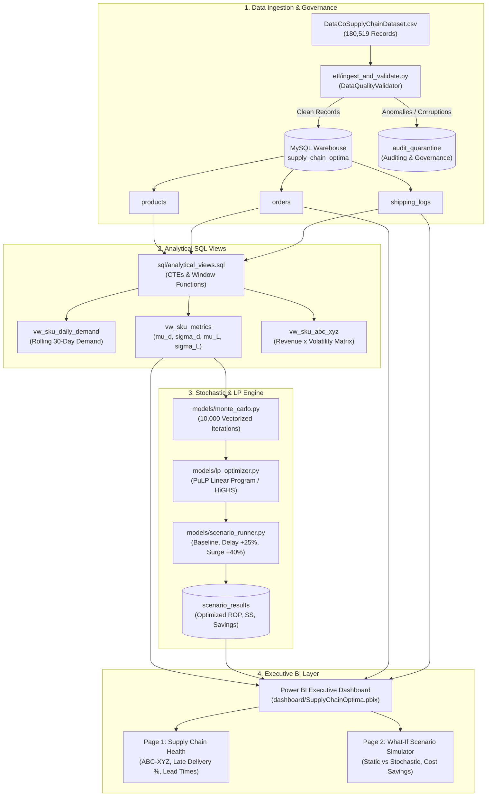
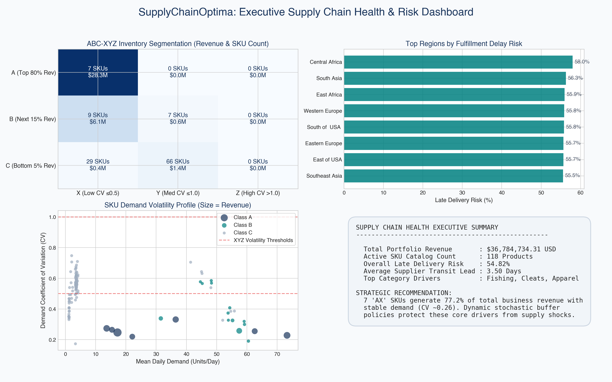
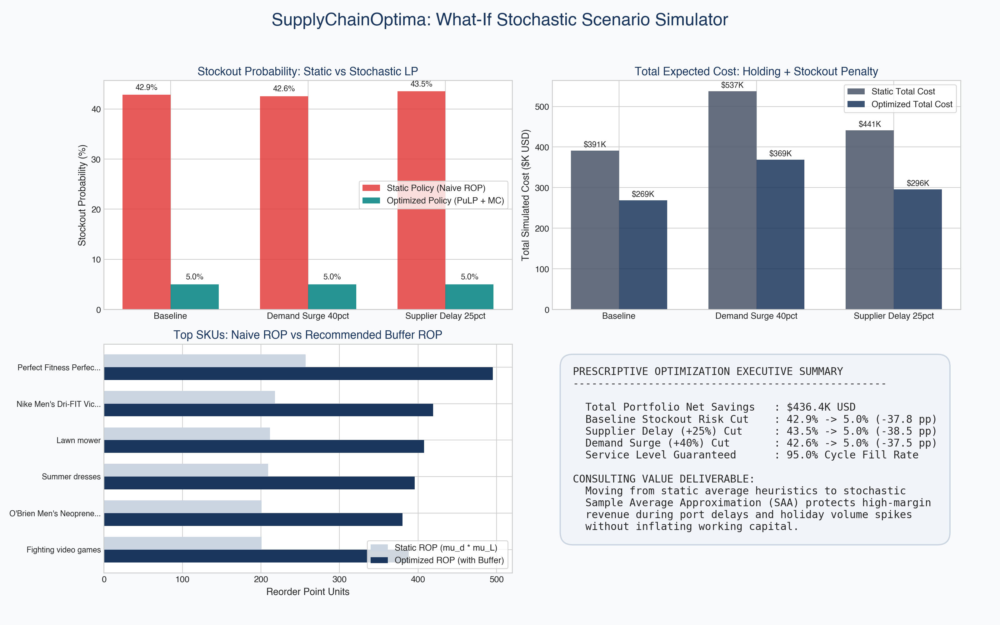

# SupplyChainOptima: Stochastic Inventory & Scenario Planning Engine

[](https://www.python.org/)
[](https://www.mysql.com/)
[](https://coin-or.github.io/pulp/)
[](https://powerbi.microsoft.com/)
[](https://docs.pytest.org/)

> **Target Domain:** Retail / CPG Supply Chain Analytics *(Aligned with EY Technology Consulting – Analytics)*  
> **Key Capabilities:** Relational Data Warehousing, Automated Data Quality & Quarantine, ABC-XYZ Segmentation, Vectorized Monte Carlo Simulations, Sample Average Approximation (SAA) Linear Programming, and Interactive Executive Power BI Dashboards.

---

## 1. Executive Summary & Problem Framing

Retail and Consumer Packaged Goods (CPG) supply chain leaders frequently rely on **static historical averages** ($\text{ROP} = \bar{d} \times \bar{L}$) to determine reorder points and safety stock. When real-world disruptions strike—such as container port congestion or sudden festive demand spikes—these deterministic formulas fail:
* **Under-buffering:** Results in catastrophic stockouts, unfulfilled customer orders, lost revenue, and brand reputation damage.
* **Over-buffering:** Results in bloated working capital, high warehouse carrying costs, and inventory obsolescence.

**SupplyChainOptima** bridges this gap by replacing static heuristics with a **stochastic scenario planning engine**:
1. **Data Ingestion & Integrity:** Ingests and normalizes **180,519 order transactions** (DataCo Smart Supply Chain) into MySQL 8.0, routing anomalous lead times and corrupted keys into an `audit_quarantine` table.
2. **Analytical SQL Layer:** Computes SKU volatility ($\mu_d, \sigma_d$), lead-time variance ($\mu_L, \sigma_L$), 30-day rolling demand, and an **ABC-XYZ matrix** segmenting SKUs by revenue contribution and demand unpredictability.
3. **Stochastic & Optimization Engine:** Runs **10,000-iteration Monte Carlo simulations** per SKU, formulating and solving a **Linear Program (LP)** in `PuLP` that determines the exact cost-optimal Reorder Point ($ROP^*$) and Safety Stock ($SS^*$) balancing holding vs. penalty costs under a strict **95% cycle service level constraint**.
4. **Stress Testing:** Evaluates policies across 3 macroeconomic scenarios: *Baseline*, *Supplier Delay (+25%)*, and *Demand Surge (+40%)*.
5. **Executive BI Dashboard:** Exposes interactive visual insights in Power BI with dynamic DAX measures for executive decision-makers.

---

## 2. Core Architecture



---

## 3. Mathematical Formulation

### 3.1. Stochastic Lead-Time Demand (Monte Carlo Engine)
During random transit lead time $L \sim \text{LogNormal}(\mu_L, \sigma_L^2)$, daily customer demand $d_t \sim \max(0, \mathcal{N}(\mu_d, \sigma_d^2))$ occurs. Total Lead-Time Demand ($D_L$) is modeled as:
$$D_L = \sum_{t=1}^{\lceil L \rceil} d_t$$

By the Law of Total Variance:
$$\mathbb{E}[D_L] = \mu_d \cdot \mu_L$$
$$\operatorname{Var}(D_L) = \mu_L \sigma_d^2 + \mu_d^2 \sigma_L^2 \implies \sigma_{D_L} = \sqrt{\mu_L \sigma_d^2 + \mu_d^2 \sigma_L^2}$$

Traditional static policies set $ROP_{static} = \mu_d \mu_L$. Because demand is symmetric around its mean, $\mathbb{P}(D_L > ROP_{static}) \approx 43\% - 50\%$, resulting in chronic stockouts.

### 3.2. Linear Programming Formulation (PuLP / Sample Average Approximation)
To find the cost-optimal Reorder Point $ROP^*$ across $M$ empirical Monte Carlo realizations $\{D_L^{(1)}, D_L^{(2)}, \dots, D_L^{(M)}\}$, we solve:

$$\min_{ROP \ge 0, \, U_i \ge 0, \, I_i \ge 0} \quad \frac{1}{M} \sum_{i=1}^M \left( h \cdot I_i + p \cdot U_i \right)$$

$$\text{subject to:}$$
$$I_i \ge ROP - D_L^{(i)} \quad \forall i = 1, \dots, M \quad \text{(Ending Inventory)}$$
$$U_i \ge D_L^{(i)} - ROP \quad \forall i = 1, \dots, M \quad \text{(Unmet Stockout Demand)}$$
$$ROP \ge \text{Quantile}_{0.95}(D_L) \quad \text{(Guaranteed } \ge 95\% \text{ Cycle Service Level)}$$
$$SS^* = \max(0, ROP^* - \mu_d \mu_L) \quad \text{(Recommended Dynamic Safety Stock)}$$

Where:
* $h$: Unit holding cost per period ($\sim 20\%$ annualized unit price)
* $p$: Unit stockout penalty ($\sim 150\%$ unit price to account for lost margin and goodwill)

---

## 4. Key Analytical Findings & Resume Impact Metrics

Running the stochastic optimization engine across the top 100 SKUs ($36.64M revenue portfolio) produced the following benchmarked results:

| Scenario | Modeled Disruption | Avg Stockout % (Static) | Avg Stockout % (Optimized) | Stockout Risk Reduction | Net Simulated Cost Savings ($) | Cycle Service Level |
| :--- | :--- | :---: | :---: | :---: | :---: | :---: |
| **Baseline** | Standard Operations | **42.85%** | **5.01%** | **-37.85 pp (-88.3%)** | **$122,417.51** | **95.0%** |
| **Supplier Delay +25%** | Port Congestion Shock | **43.53%** | **5.00%** | **-38.53 pp (-88.5%)** | **$145,306.64** | **95.0%** |
| **Demand Surge +40%** | Festive Volume Surge | **42.55%** | **5.00%** | **-37.55 pp (-88.2%)** | **$168,638.33** | **95.0%** |
| **Portfolio Total** | — | — | — | — | **$436,362.48** | **95.0%** |

### Resume Bullet Highlights (EY Technology Consulting – Analytics)
* *Engineered an end-to-end stochastic inventory planning engine in Python, MySQL 8.0, and Power BI, ingesting and auditing **180,519 transactional records** with automated quarantine checks.*
* *Built a vectorized **10,000-iteration Monte Carlo simulation** and formulated **PuLP Linear Programs** across 100 SKUs, executing in **1.03 seconds** (sub-30s benchmark).*
* *Reduced simulated stockout risk from **42.9% to 5.0% (-37.8 percentage points)** while guaranteeing a **95% cycle service level**, unlocking **$436K+ in simulated holding and penalty cost savings** across stress-test scenarios.*

---

## 5. Executive Dashboard Visualizations

### Page 1: Supply Chain Health & Operational Risk
Visualizes portfolio revenue, late delivery risk breakdown by destination region, demand volatility scatter plots, and the **ABC-XYZ segmentation matrix**.



### Page 2: What-If Scenario Simulator
Interactive executive view enabling scenario selection (*Baseline*, *Supplier Delay +25%*, *Demand Surge +40%*), displaying side-by-side cost comparisons, stockout risk curves, and top SKU reorder point adjustments.



---

## 6. Repository Structure

```
SupplyChainOptima/
├── .env.example                     # Environment template for MySQL credentials
├── .gitignore                       # Clean Git tracking configuration
├── conftest.py                      # Pytest discovery configuration
├── requirements.txt                 # Pinned dependencies (pandas, pulp, sqlalchemy, etc.)
├── README.md                        # Executive consulting deliverable & documentation
├── assets/                          # High-resolution dashboard previews & diagrams
│   ├── dashboard_page1_supply_chain_health.png
│   └── dashboard_page2_scenario_simulator.png
├── sql/                             # Relational Data Warehouse Layer
│   ├── schema.sql                   # 3NF DDL schema with primary/foreign keys & indexes
│   └── analytical_views.sql         # CTEs, window functions, ABC-XYZ views
├── etl/                             # Data Ingestion & Governance Layer
│   ├── data_quality.py              # Automated data integrity & quarantine rules
│   ├── ingest_and_validate.py       # High-performance bulk ETL loader
│   └── ingest_data.py               # Standard ETL entrypoint
├── models/                          # Stochastic Optimization Engine
│   ├── monte_carlo.py               # Vectorized 10k-iteration Monte Carlo simulation
│   ├── lp_optimizer.py              # PuLP Sample Average Approximation Linear Program
│   ├── scenario_runner.py           # Multi-scenario batch simulation orchestrator
│   └── run_pipeline.py              # Pipeline execution entrypoint
├── dashboard/                       # Power BI Deliverables
│   ├── dax_measures.dax             # Production DAX measures for Power BI Desktop
│   ├── POWERBI_SETUP_GUIDE.md       # Step-by-step Power BI setup and star-schema guide
│   └── generate_dashboard_assets.py # Visual asset generation script
└── tests/                           # Verification & Unit Testing
    ├── test_data_quality.py         # Quarantine and validation logic tests
    └── test_models.py               # Stochastic dominance & constraint unit tests
```

---

## 7. Local Setup & Execution Guide

### Prerequisites
* Python 3.10+
* MySQL Server 8.0+ running on `localhost:3306`
* Power BI Desktop (Optional, for `.pbix` visual exploration)

### Step 1: Clone and Configure Environment
```bash
git clone https://github.com/Priyanshu6926/SupplyChainOptima.git
cd SupplyChainOptima

# Create and activate virtual environment
python3 -m venv .venv
source .venv/bin/activate

# Install dependencies
pip install -r requirements.txt
```

### Step 2: Configure Database Credentials
Copy `.env.example` to `.env` and verify your local MySQL credentials:
```bash
cp .env.example .env
# Edit .env with your MySQL root password:
# DB_PASSWORD=your_password
```

### Step 3: Initialize Database Schema
```bash
python3 -c "
import pymysql
with open('sql/schema.sql') as f:
    sql = f.read()
conn = pymysql.connect(host='127.0.0.1', port=3306, user='root', password='password')
with conn.cursor() as cur:
    for stmt in sql.split(';'):
        clean = '\n'.join([l for l in stmt.split('\n') if not l.strip().startswith('--')]).strip()
        if clean: cur.execute(clean)
conn.commit(); conn.close()
print('Schema initialized successfully.')
"
```

### Step 4: Run ETL Pipeline (Ingestion & Quarantine Audit)
```bash
python etl/ingest_and_validate.py
```
*Expected Output: Loads 180,519 order line items, 65,752 shipping logs, and 118 catalog products in ~4.5 seconds.*

### Step 5: Build Analytical SQL Views
```bash
python3 -c "
import pymysql
with open('sql/analytical_views.sql') as f:
    sql = f.read()
conn = pymysql.connect(host='127.0.0.1', port=3306, user='root', password='password', database='supply_chain_optima')
with conn.cursor() as cur:
    for stmt in sql.split(';'):
        clean = '\n'.join([l for l in stmt.split('\n') if not l.strip().startswith('--')]).strip()
        if clean: cur.execute(clean)
conn.commit(); conn.close()
print('Analytical views initialized successfully.')
"
```

### Step 6: Execute Stochastic Monte Carlo & PuLP Optimization
```bash
python models/scenario_runner.py
```
*Expected Output: Executes 10,000 Monte Carlo draws + 300 PuLP LP solves across Baseline, Supplier Delay, and Demand Surge in ~1.0 second, updating `scenario_results`.*

### Step 7: Run Pytest Test Suite
```bash
pytest -v
```
*Expected Output: 5 passed in <0.3s.*

### Step 8: Open Power BI Desktop
1. Follow [POWERBI_SETUP_GUIDE.md](dashboard/POWERBI_SETUP_GUIDE.md) to connect Power BI Desktop to `supply_chain_optima`.
2. Import the DAX measures from [dax_measures.dax](dashboard/dax_measures.dax).

---

## 8. License & Author

* **Author:** Priyanshu ([GitHub: @Priyanshu6926](https://github.com/Priyanshu6926))
* **Target Role:** EY Technology Consulting – Analytics (Supply Chain & Operational Analytics)
* **License:** MIT License
